# examples/ — Suite de modelos FMU de ejemplo

28 modelos FMU que cubren los casos de uso mas habituales del codegen: desde sistemas algebraicos puros hasta ODE no lineales, logica discreta, arrays, Strings y Co-Simulacion. Cada modelo tiene una bateria de 7-12 test cases con checks automaticos.

---

## Galeria de modelos

<table>
  <tr>
    <td align="center" width="220">
      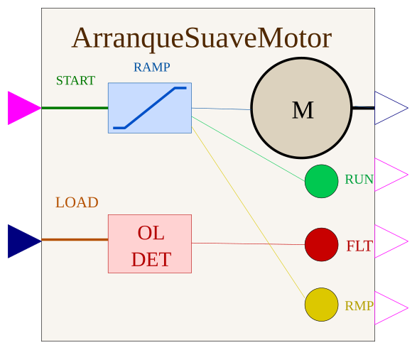<br>
      <b>ArranqueSuaveMotor</b><br>
      <sub>Motor con rampa suave + sobrecarga</sub>
    </td>
    <td align="center" width="220">
      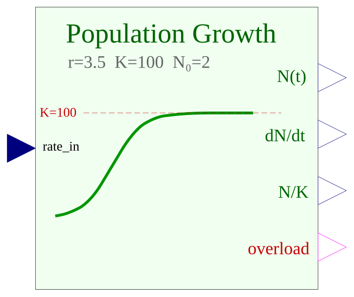<br>
      <b>CrecimientoPoblacional</b><br>
      <sub>Ecuacion logistica</sub>
    </td>
    <td align="center" width="220">
      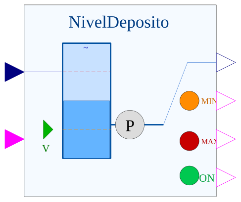<br>
      <b>NivelDeposito</b><br>
      <sub>Deposito con entrada/salida</sub>
    </td>
    <td align="center" width="220">
      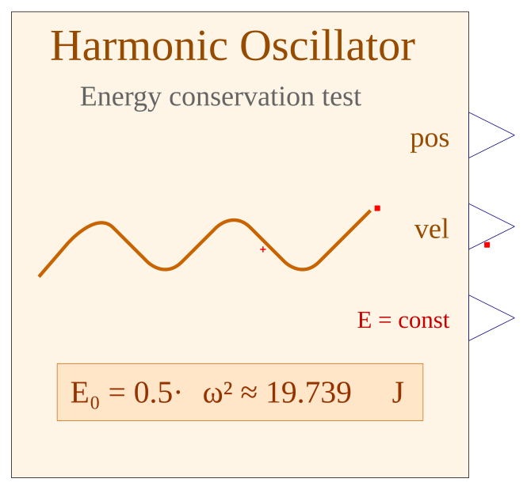<br>
      <b>OsciladorArmonico</b><br>
      <sub>Masa-muelle-amortiguador</sub>
    </td>
  </tr>
  <tr>
    <td align="center" width="220">
      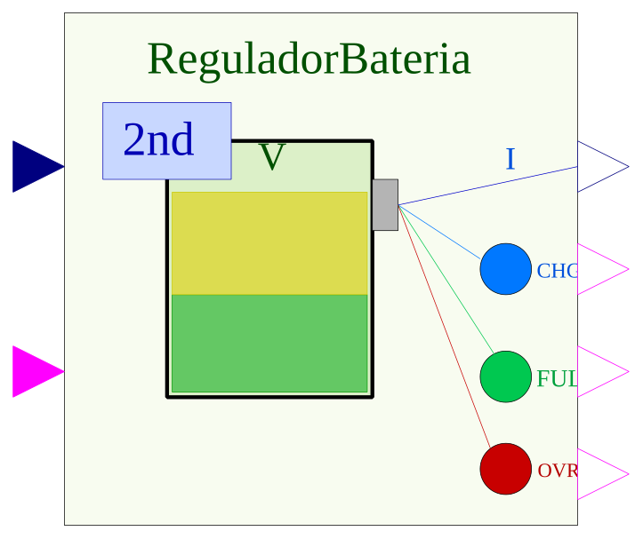<br>
      <b>ReguladorBateria</b><br>
      <sub>Cargador con proteccion sobretension</sub>
    </td>
    <td align="center" width="220">
      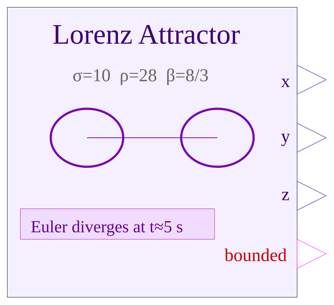<br>
      <b>SistemaLorenz</b><br>
      <sub>Atractor caotico (3 estados)</sub>
    </td>
    <td align="center" width="220">
      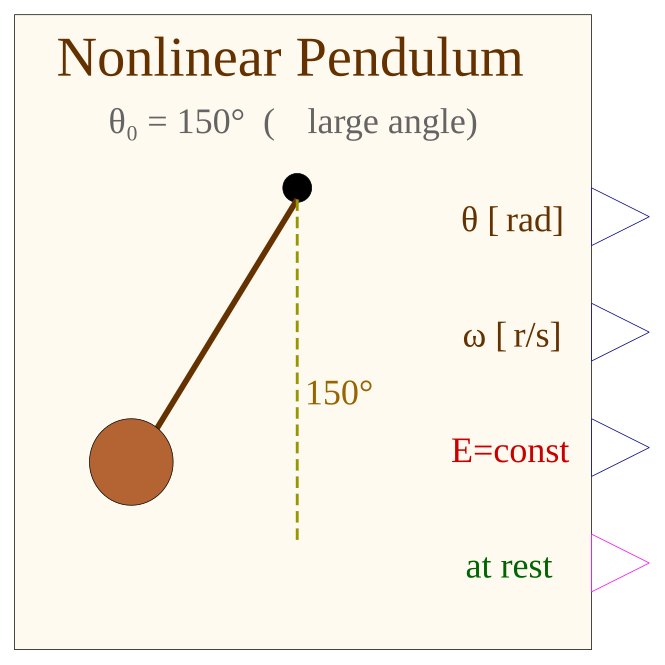<br>
      <b>PenduloNoLineal</b><br>
      <sub>Pendulo con deteccion de reposo</sub>
    </td>
    <td align="center" width="220">
      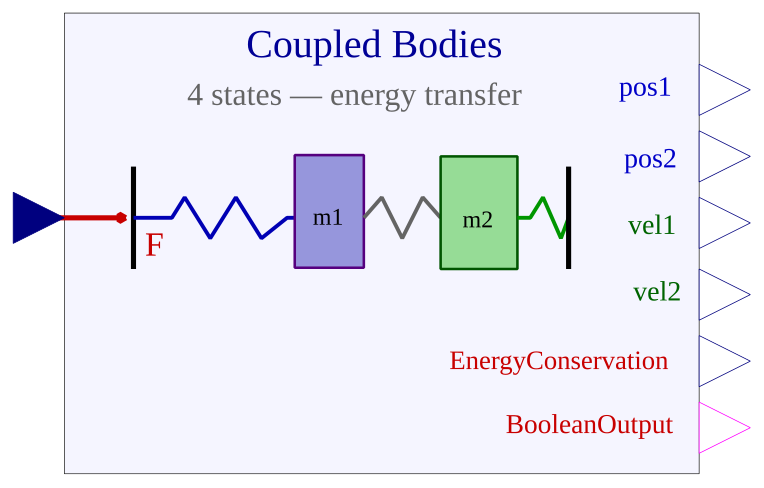<br>
      <b>CuerposAcoplados</b><br>
      <sub>Dos masas acopladas por muelle</sub>
    </td>
  </tr>
  <tr>
    <td align="center" width="220">
      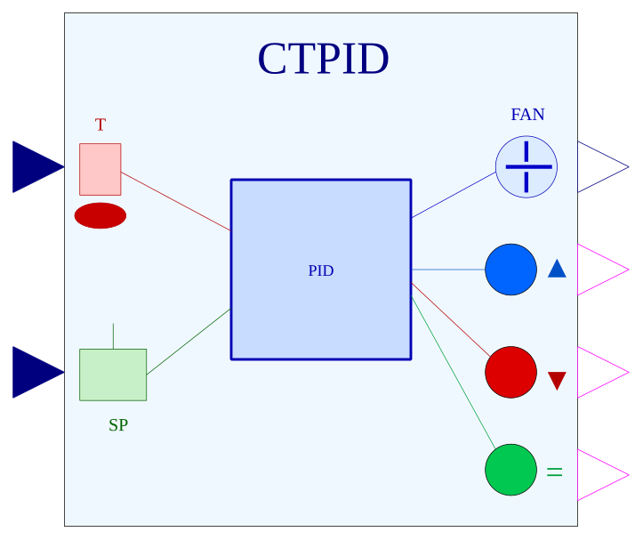<br>
      <b>CTPID</b><br>
      <sub>Control PID de temperatura</sub>
    </td>
    <td align="center" width="220">
      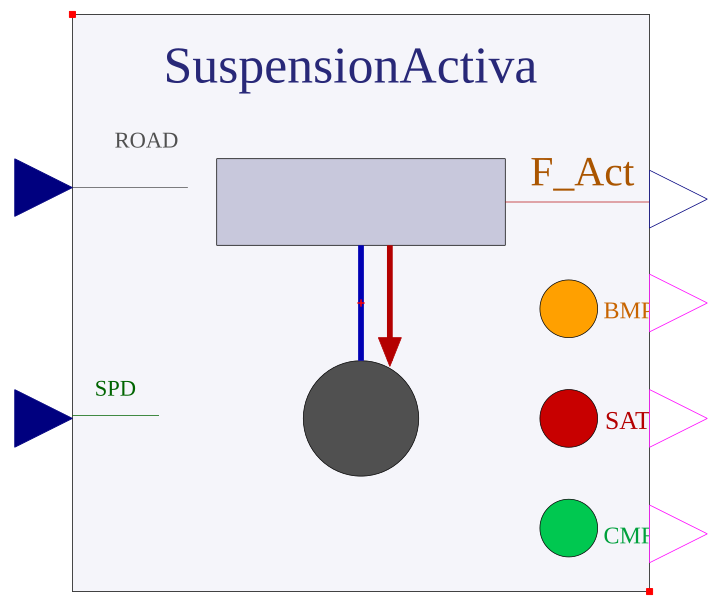<br>
      <b>SuspensionActiva</b><br>
      <sub>Suspension activa con deteccion bache</sub>
    </td>
    <td align="center" width="220">
      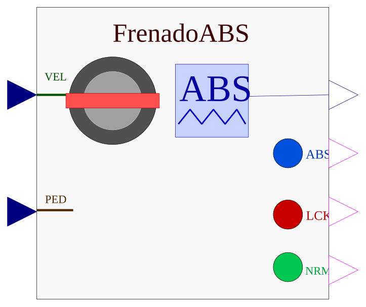<br>
      <b>FrenadoABS</b><br>
      <sub>Sistema ABS con modelo neumatico</sub>
    </td>
    <td align="center" width="220">
      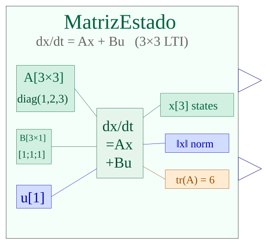<br>
      <b>MatrizEstado</b><br>
      <sub>Sistema lineal x'=Ax+Bu (3x3)</sub>
    </td>
  </tr>
  <tr>
    <td align="center" width="220">
      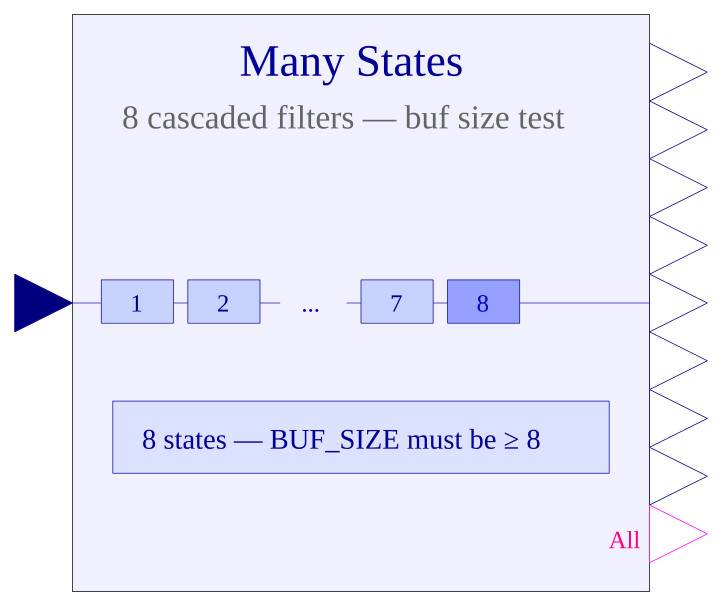<br>
      <b>MuchosEstados</b><br>
      <sub>Cadena de 8 filtros de primer orden</sub>
    </td>
    <td align="center" width="220">
      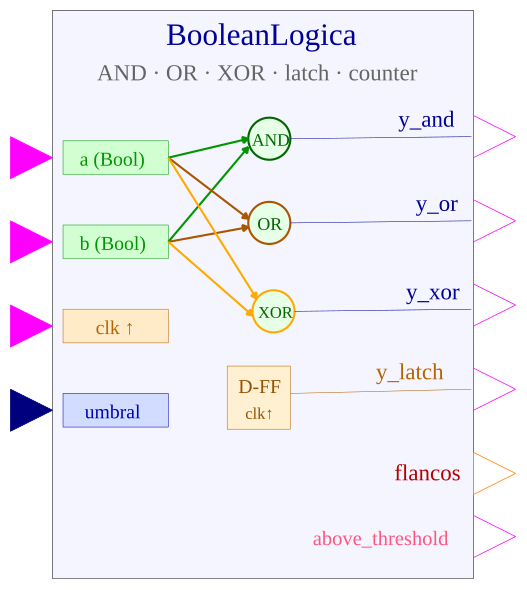<br>
      <b>BooleanLogica</b><br>
      <sub>D-latch y contador de flancos</sub>
    </td>
    <td align="center" width="220">
      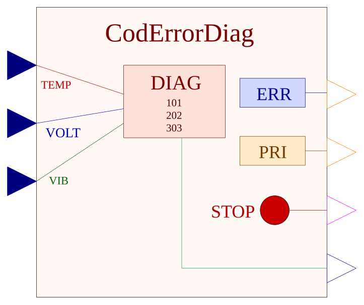<br>
      <b>CodigoErrorDiagnostico</b><br>
      <sub>Diagnostico con prioridades de fallo</sub>
    </td>
    <td align="center" width="220">
      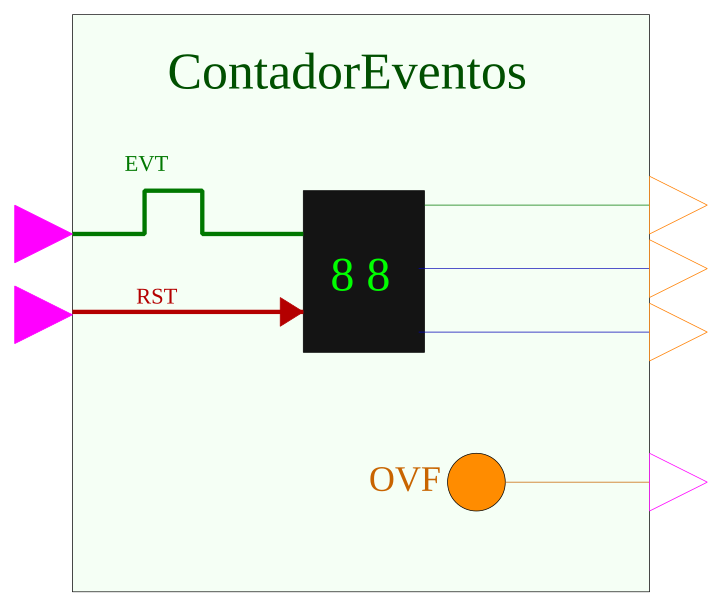<br>
      <b>ContadorEventos</b><br>
      <sub>Contador BCD con saturacion en 99</sub>
    </td>
  </tr>
  <tr>
    <td align="center" width="220">
      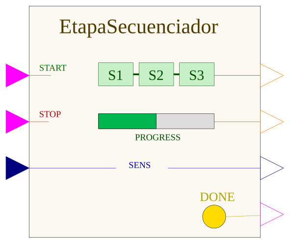<br>
      <b>EtapaSecuenciador</b><br>
      <sub>Secuenciador de 3 etapas</sub>
    </td>
    <td align="center" width="220">
      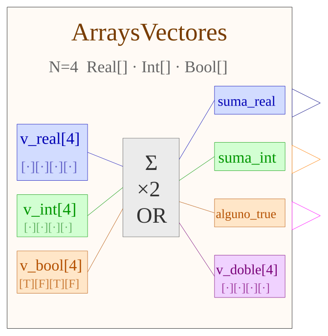<br>
      <b>ArraysVectores</b><br>
      <sub>Array de 4 elementos con OR booleano</sub>
    </td>
    <td align="center" width="220">
      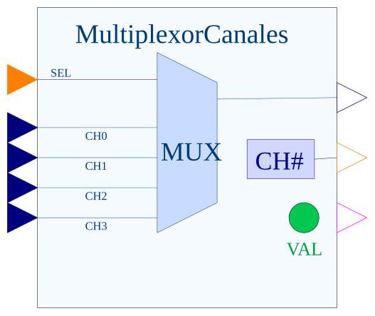<br>
      <b>MultiplexorCanales</b><br>
      <sub>Multiplexor de 4 canales</sub>
    </td>
    <td align="center" width="220">
      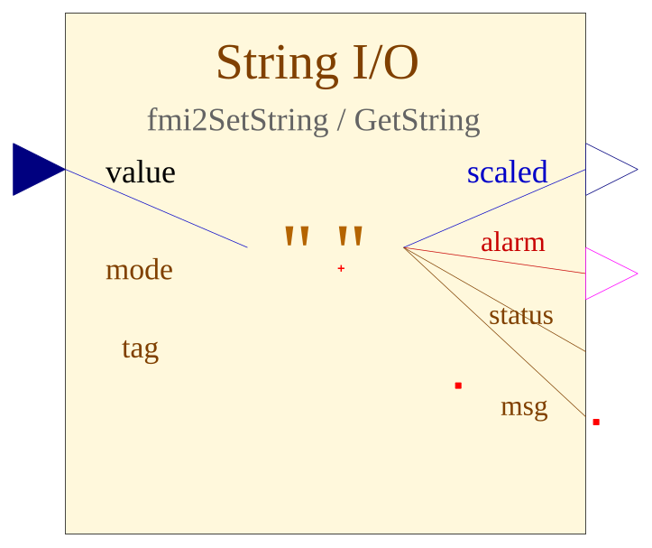<br>
      <b>StringInputOutput</b><br>
      <sub>Entradas/salidas String</sub>
    </td>
  </tr>
  <tr>
    <td align="center" width="220">
      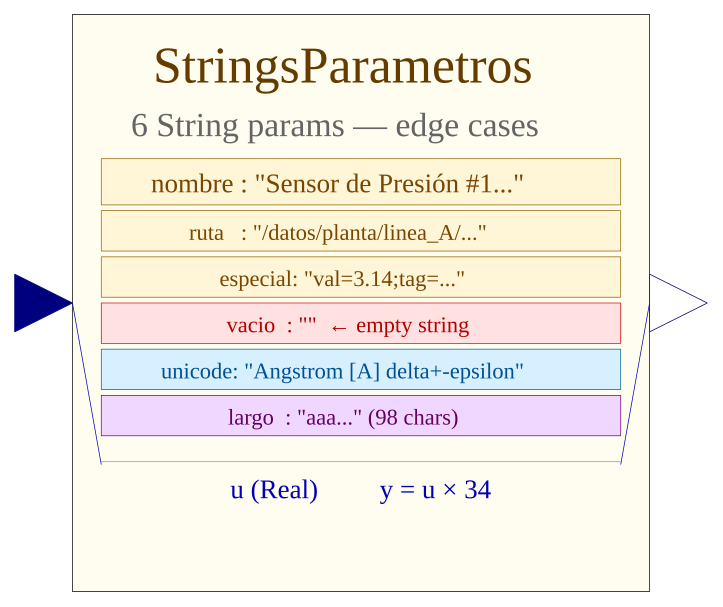<br>
      <b>StringsParametros</b><br>
      <sub>Parametros String con logica</sub>
    </td>
    <td align="center" width="220">
      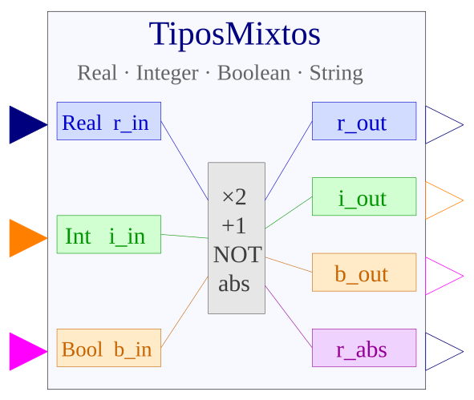<br>
      <b>TiposMixtos</b><br>
      <sub>Real, Integer y Boolean en paralelo</sub>
    </td>
    <td align="center" width="220">
      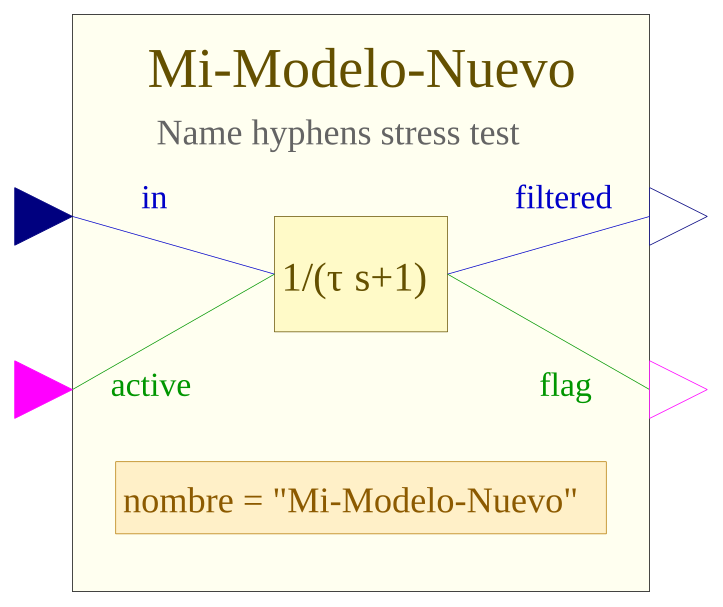<br>
      <b>MiModeloNuevo</b><br>
      <sub>Suma y escala de dos entradas</sub>
    </td>
    <td align="center" width="220">
      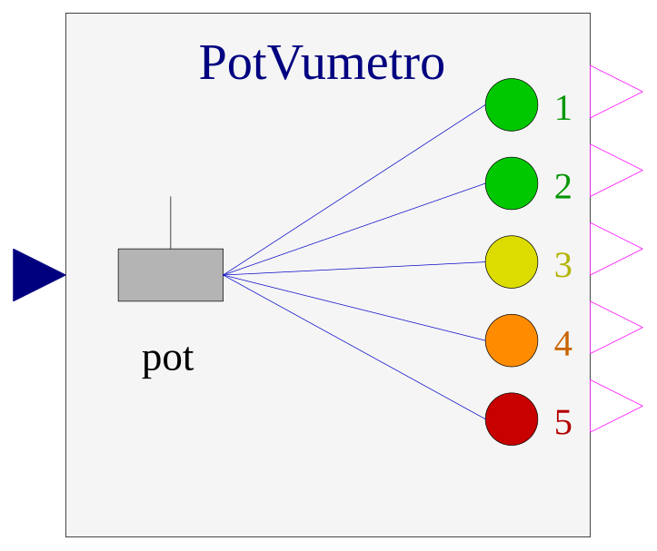<br>
      <b>PotVumetro</b><br>
      <sub>Potenciometro + vumetro</sub>
    </td>
  </tr>
  <tr>
    <td align="center" width="220">
      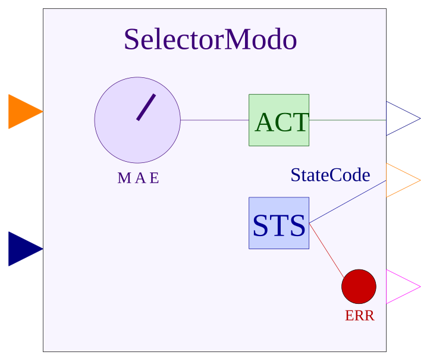<br>
      <b>SelectorModo</b><br>
      <sub>Selector de modo de operacion</sub>
    </td>
    <td align="center" width="220">
      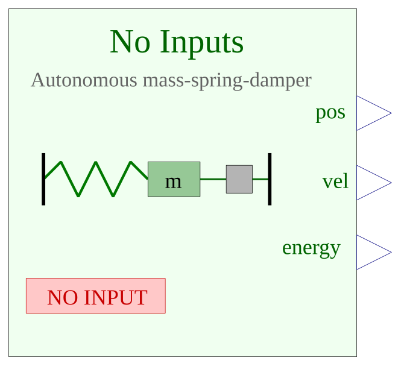<br>
      <b>SinInputs</b><br>
      <sub>Solo parametros internos</sub>
    </td>
    <td align="center" width="220">
      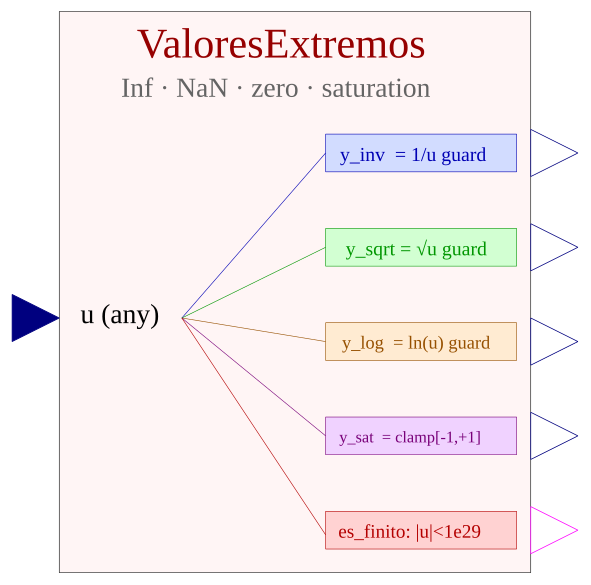<br>
      <b>ValoresExtremos</b><br>
      <sub>Protecciones numericas</sub>
    </td>
    <td align="center" width="220">
      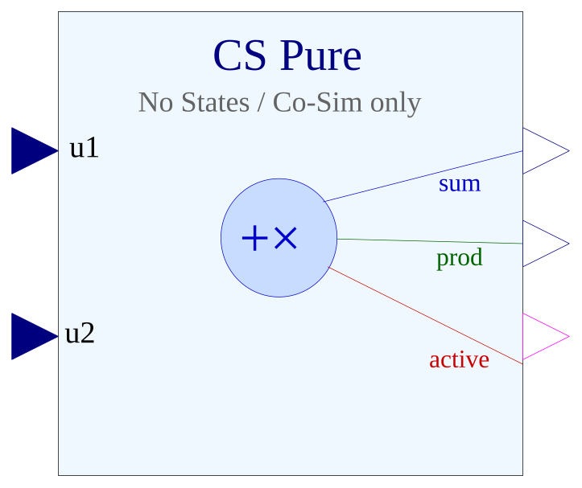<br>
      <b>CSPuro</b><br>
      <sub>Co-Simulation puro algebraico</sub>
    </td>
  </tr>
</table>

---

## Tabla de modelos

### Algebraicos (sin estados)

Modelos puramente combinacionales sin integracion dinamica.

| Modelo | Descripcion | TCs |
|--------|-------------|-----|
| `mimodelonuevo` | Suma y escala de dos entradas Real | 10 |
| `potvumetro` | Potenciometro + vumetro con zona muerta | 12 |
| `selectormodo` | Selector de modo de operacion (enum) | 10 |
| `sininputs` | Modelo sin entradas — solo parametros internos | 8 |
| `valoresextremos` | Protecciones numericas: division por cero, log, sqrt, saturacion | 10 |

### ODE — sistemas de primer orden

Sistemas con 1-3 estados dinamicos de primer orden.

| Modelo | Descripcion | TCs |
|--------|-------------|-----|
| `arranquesuavemotor` | Motor con rampa suave (cascada PT1 + limitador) y deteccion de sobrecarga | 10 |
| `crecimientopoblacional` | Ecuacion logistica con capacidad de carga | 10 |
| `niveldeposito` | Deposito con entrada y salida — nivel con saturacion | 10 |
| `osciladorarmonico` | Oscilador masa-muelle-amortiguador (2 estados) | 10 |
| `reguladorbateria` | Regulador de carga de bateria con proteccion de sobretension | 7 |

### ODE — sistemas complejos

Sistemas no lineales o de alto orden.

| Modelo | Descripcion | TCs |
|--------|-------------|-----|
| `cuerposacoplados` | Dos masas acopladas por muelle — batido de modos | 10 |
| `ctpid` | Control PID de temperatura con actuador saturado y LEDs de estado | 10 |
| `pendulonolineal` | Pendulo no lineal con deteccion de reposo | 10 |
| `sistemalorenz` | Atractor de Lorenz caotico (3 estados) | 10 |
| `suspensionactiva` | Suspension activa con filtro de deteccion de bache y modo confort | 10 |

### Alta dimension (5+ estados)

Modelos con muchos estados que estresan el buffer de solvers.

| Modelo | Descripcion | TCs |
|--------|-------------|-----|
| `frenadoabs` | Sistema ABS con modelo de neumatico y dinamica de rueda | 10 |
| `matrizestado` | Sistema lineal x' = Ax + Bu (3x3) | 10 |
| `muchosestados` | Cadena de 8 filtros de primer orden en cascada | 10 |

### Logica discreta y eventos

Automatas, contadores y logica booleana.

| Modelo | Descripcion | TCs |
|--------|-------------|-----|
| `booleanlogica` | D-latch, contador de flancos, logica combinacional | 10 |
| `codigoerrordiagnostico` | Sistema de diagnostico con prioridades de fallo (3 canales) | 10 |
| `contadoreventos` | Contador de pulsos con representacion BCD y saturacion en 99 | 10 |
| `etapasecuenciador` | Secuenciador de 3 etapas con sensor de progreso y parada | 12 |

### Tipos de datos avanzados

Arrays, Strings, tipos mixtos.

| Modelo | Descripcion | TCs |
|--------|-------------|-----|
| `arraysvectores` | Array de 4 elementos Real + Integer con OR booleano | 10 |
| `multiplexorcanales` | Multiplexor de 4 canales con selector Integer | 10 |
| `stringinputoutput` | Entradas/salidas String — escala y alarma de rango | 10 |
| `stringsparametros` | Parametros String con logica condicional | 10 |
| `tiposmixtos` | Modelo con Real, Integer y Boolean en paralelo | 10 |

### Co-Simulacion (CS)

Modelos que usan FMI Co-Simulation en lugar de Model Exchange.

| Modelo | Descripcion | TCs |
|--------|-------------|-----|
| `cspuro` | Modelo CS puro algebraico — suma, producto y comparacion | 10 |

---

## Estado de la suite

```
Modelos:     23/28 PASS  (82%)
Test cases:  242/279 PASS  (86%)
```

Informe completo: [../results/suite_summary.md](../results/suite_summary.md)

Los 5 modelos con fallos tienen limitaciones del FMU generado por OpenModelica que no son corregibles desde los tests (ver seccion de limitaciones al final de este documento).

---

## Como ejecutar los tests

### Suite completa

```bash
# Desde la raiz del proyecto
python tools/run_all_tests.py
```

Genera `results/suite_summary.md` con el informe global y un informe individual por test case en `examples/<modelo>/host/test/results/`.

### Un modelo especifico

```bash
python examples/sistemalorenz/host/test/test_sistemalorenz_full.py
```

### Requisitos Python

```bash
pip install matplotlib   # para graficas (opcional — los tests pasan sin ella)
```

---

## Como interpretar los resultados

Cada test case genera un directorio `results/TC-<ID>/` con:

- `sim_me_rk4.csv` — datos de la simulacion (columnas: `t`, y una por variable de salida)
- `sim_me_rk4.png` — grafica de todas las variables
- `report_TC-<ID>.md` — informe detallado con checks, estadisticas y analisis contextual

El informe por modelo (`results/summary.md`) resume el estado de todos los TCs.

---

## Estructura de una bateria de tests

Cada bateria es un archivo `test_<modelo>_full.py` con un diccionario `CONFIG`:

```python
CONFIG = {
    "model_name": "NombreModelo",   # debe coincidir con el nombre del FMU
    "tests": [
        {
            "id":          "TC-XX-001",
            "title":       "Titulo corto del caso",
            "description": "Una linea describiendo entradas y salidas esperadas.",
            "t_end":  1.0,          # tiempo final de simulacion (s)
            "h":      0.01,         # paso de integracion (s)
            "solver": "rk4",        # "rk4" o "euler"
            "mode":   "me",         # "me" (Model Exchange) o "cs" (Co-Simulation)
            "inputs": {             # valores constantes de entradas
                "nombre_entrada": valor,
            },
            "schedule": {           # cambios de entrada en el tiempo (opcional)
                "nombre_entrada": [(t0, v0), (t1, v1), ...],
            },
            "checks": [...],        # lista de verificaciones (ver seccion siguiente)
            "interpretation": "Explicacion del comportamiento esperado.",
        },
    ]
}

if __name__ == "__main__":
    from full_test_runner import run_battery
    run_battery(__file__)
```

---

## Referencia de tipos de check

### `final_value` — valor en el ultimo paso

```python
{"col": "temperatura", "type": "final_value", "val": 25.0, "tol": 0.1}
```

Comprueba que el valor final de `col` esta dentro de `val ± tol`.

---

### `at_t` — valor en un instante concreto

```python
{"col": "tension", "type": "at_t", "at_t": 0.5, "val": 0.75, "tol": 0.01}
```

Selecciona la fila mas proxima a `at_t` y comprueba `val ± tol`.

---

### `always` — condicion verdadera en todos los pasos

```python
{"col": "corriente", "type": "always", "op": ">=", "val": 0.0}
```

Operadores disponibles: `>`, `>=`, `<`, `<=`, `==`, `!=`.
Para `==` usa tolerancia `1e-9` internamente.

---

### `eventually` — condicion verdadera en algun paso

```python
{"col": "alarma", "type": "eventually", "op": "==", "val": 1}
```

Util cuando un evento tarda en activarse (p. ej. histeresis, dinamica transitoria).

---

### `bounded` — variable acotada en un rango

```python
{"col": "corriente", "type": "bounded", "low": 0.0, "high": 1.1}
```

Falla si cualquier valor sale del intervalo `[low, high]`.

---

### `no_nan_inf` — sin valores invalidos

```python
{"col": "energia", "type": "no_nan_inf"}
```

Falla si cualquier valor es NaN o Inf.

---

### `monotone_dec` / `monotone_inc` — monotonia estricta

```python
{"col": "nivel", "type": "monotone_dec"}
{"col": "carga", "type": "monotone_inc"}
```

Comprueba que la variable nunca sube (o nunca baja) a lo largo de la simulacion.

---

### `sign_changes` — numero de cruces por cero

```python
{"col": "velocidad_angular", "type": "sign_changes", "min_count": 4}
```

Cuenta cuantas veces la variable cambia de signo (negativo→positivo o viceversa).
**Nota:** solo tiene sentido para variables que toman valores negativos. No usar con booleanos (0/1).

---

### `count_value` — numero de veces que aparece un valor

```python
# Al menos N veces:
{"col": "en_reposo", "type": "count_value", "val": 1, "min_count": 3}

# Exactamente N veces:
{"col": "estado", "type": "count_value", "val": 2, "expected": 5}
```

---

### `range_at_t` — rango en un instante concreto

```python
{"col": "posicion", "type": "range_at_t", "at_t": 2.0, "low": 0.3, "high": 0.7}
```

---

## Trampas frecuentes al escribir tests

### Histeresis de OpenModelica (`relationhysteresis`)

OpenModelica implementa todas las comparaciones booleanas con histeresis para estabilidad numerica. Esto produce dos efectos:

**1. Frontera exacta con operador `<`:**
Una entrada constante fijada exactamente en el umbral **dispara un falso positivo**. Usar un valor ligeramente alejado de la frontera.

```python
# Umbral de subtension es 0.10 — usar 0.11, no 0.10
"inputs": {"tension": 0.11}

# Umbral de velocidad es 0.30 — usar 0.31, no 0.30
"inputs": {"velocidad": 0.31}
```

**2. Estado inicial en t=0:**
Antes de que los inputs se apliquen via `fmi2SetReal`, el FMU evalua condiciones con los valores por defecto (tipicamente 0). Algunos booleans arrancan en el estado "incorrecto" durante exactamente 1 paso.

```python
# Verificar en t=0.01 en lugar de t=0.0 cuando el primer paso es de inicializacion
{"col": "modo_activo", "type": "at_t", "at_t": 0.01, "val": 0, "tol": 0}
```

### Cascadas de filtros

Un modelo con N filtros de primer orden en cascada NO tiene la respuesta de un unico filtro. Para dos filtros con constantes tau1 y tau2:

```
y(t) = 1 - (tau1/(tau1-tau2)) * e^(-t/tau1) + (tau2/(tau1-tau2)) * e^(-t/tau2)
```

### Condiciones estrictas en fronteras

La condicion `x > umbral` es FALSE cuando `x == umbral` exacto. Verificar con valores ligeramente por encima o por debajo.

### Variables booleanas y `sign_changes`

`sign_changes` cuenta cruces por cero en sentido algebraico. Una variable booleana (0/1) nunca es negativa, por lo que `sign_changes` siempre devuelve 0. Usar `eventually` o `count_value` en su lugar.

---

## Limitaciones conocidas del codegen (modelos con fallos no corregibles)

| Modelo | Causa | Detalle |
|--------|-------|---------|
| `arraysvectores` | Causality local | Las entradas array tienen `causality="local"` en el FMU — `fmi2SetReal` no puede modificarlas |
| `booleanlogica` | Bug storePreValues | OpenModelica llama `storePreValues()` antes que `functionDAE()` en el bucle de eventos — `pre(x)` nunca detecta flancos ascendentes |
| `contadoreventos` | Bug storePreValues | Mismo problema que BooleanLogica |
| `etapasecuenciador` | Bug storePreValues | Mismo problema que BooleanLogica |
| `matrizestado` | Constant-folding | El termino `B*u` se constant-fold a cero en tiempo de compilacion de OpenModelica — la entrada `u` no tiene efecto |

Estos fallos son del FMU generado, no del adapter ni del codegen. No se pueden solucionar modificando los tests.

---

## Anadir un modelo nuevo a la suite

1. Exportar la FMU con codigo fuente desde OpenModelica.
2. Generar los adapters:
   ```bash
   python tools/fmu_codegen_host.py models/MiModelo examples/mimodelo/host/
   python tools/fmu_codegen_mcu.py  models/MiModelo examples/mimodelo/mcu/
   ```
3. Compilar:
   ```bash
   cmake --build build --target mimodelo_host_me mimodelo_host_cs --config Release
   ```
4. Crear `examples/mimodelo/host/test/test_mimodelo_full.py` con el `CONFIG` dict.
5. Ejecutar:
   ```bash
   python examples/mimodelo/host/test/test_mimodelo_full.py
   ```
6. El modelo aparece automaticamente en `run_all_tests.py` (descubrimiento automatico).
